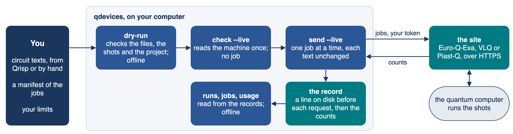

# eurohpc-qdevices

A small app that sends a fixed list of circuits to a EuroHPC quantum computer, one job at a time, and
keeps an exact record of what was sent and what came back. For **Euro-Q-Exa** (LRZ), **VLQ**
(IT4Innovations) and **Piast-Q** (PCSS).

**To get onto the machines**, follow the ENCCS lesson
[EuroHPC JU quantum devices and HPC-QC access in practice](https://enccs.github.io/eurohpc-quantum-devices-access-hpcqc/).

## What it does



- **Checks** a manifest offline: the circuit files, their SHA-256, the shots and the project (`dry-run`).
- **Reads** the machine once before a run, and sends no job (`check --live`).
- **Sends** the jobs in order, one at a time, each text exactly as it is in its file (`send --live`).
- **Does not write the circuits.** You bring each one as a text in the form its site takes: OpenQASM for
  Euro-Q-Exa, which compiles it; OpenQASM 3 in the machine's own gates (`r`, `cz`, `move`) for VLQ, which
  runs it as written; the broker's list of operations for Piast-Q. In [`examples/`](examples/README.md) the
  texts are written by hand, by a short Python function of the tutorial (`examples/hamiltonian/chain.py`,
  for 11 of the 37 Euro-Q-Exa jobs), or built as Qrisp programs and converted to OpenQASM 2 by
  `examples/qrisp/qasm2.py`, a short converter of the examples, not of the app
  ([how](content/qrisp.md#how-the-text-is-written)). The README of each folder says how its text was made.
- **Records** a line on disk before each request, and the counts when they come. After a crash, `--resume`
  collects the open jobs and never sends them again.
- **Keeps to** your limits: the projects you name, the shots of one job, and your budget of seconds on the
  site. A result that took longer than your time limit for one job stops the run; the app cuts no job short.
- **Shows** runs, jobs and usage from the records, offline.
- **Never** cancels a job, sends one twice, or stores or prints a token.

## Emulate the examples, with no account

In your browser, with nothing to install:

[](https://mybinder.org/v2/gh/ENCCS/eurohpc-qdevices/main?urlpath=lab/tree/examples/all_examples.ipynb) all the examples, side by side with what the machines gave

[](https://mybinder.org/v2/gh/ENCCS/eurohpc-qdevices/main?urlpath=lab/tree/examples/hamiltonian/tutorial.ipynb) the Hamiltonian simulation tutorial, from the Schrödinger equation to a job on a quantum computer

[](https://mybinder.org/v2/gh/ENCCS/eurohpc-qdevices/main?urlpath=lab/tree/examples/hamiltonian/two_spins/two_spins.ipynb) two spins in a field: the short start to Hamiltonian simulation

Each opens in JupyterLab, where File > New > Terminal gives a terminal: `cd examples/qrisp/bell && ./emulate.sh`
runs an example there as on your own computer. The first start can take some minutes.

Or on your own computer:

```bash
git clone --depth 1 https://github.com/ENCCS/eurohpc-qdevices
cd eurohpc-qdevices/examples/qrisp/bell
./emulate.sh
```

Each folder of [`examples/`](examples/README.md) explains itself, with its README and scripts.

## Install and first run

```bash
pixi init my-runs && cd my-runs
pixi add "python=3.12"
pixi add --pypi "eurohpc-qdevices @ git+https://github.com/ENCCS/eurohpc-qdevices"
```

Put your projects and limits in `~/.config/qdevices/qdevices.toml`; start from
[`examples/qdevices.toml`](examples/qdevices.toml). `examples/` has a manifest for each site.

```bash
pixi run qdevices dry-run MANIFEST                          # offline: the files, their SHA-256, shots, project
pixi run qdevices login SITE                                # how to get the token
pixi run qdevices check SITE --live --manifest MANIFEST     # one read of the machine, no job
pixi run qdevices send MANIFEST --live --max-order 1        # the first job alone
```

To run an example on the machine, give its `manifest.json` your own names; `./run.sh --live` in its folder then
runs the last two commands.

## Manual, tests and licence

The manual is in `content/`; `pixi run docs` builds it. Read its Live runs page and the page of your site
before a live run.

```bash
pixi run -e test test     # offline, with fake sites
pixi run --manifest-path examples/qrisp/pixi.toml test    # the same, and the Qrisp examples made again
```

Code: MIT (`LICENSE.code`). Manual: CC BY-SA 4.0 (`LICENSE`). Citation: `CITATION.cff`, or the DOI of all
versions, [10.5281/zenodo.23974192](https://doi.org/10.5281/zenodo.23974192).
