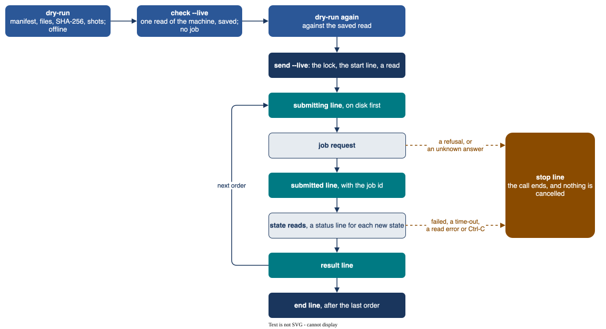

# Commands

Give `qdevices COMMAND ...`; `SITE` is `euroqexa`, `vlq` or `piastq`. The bare command prints the help
and sends nothing. `qdevices --version` prints the version, `qdevices COMMAND --help` the arguments.

| Command | Network |
|---|---|
| `qdevices check SITE [--live] [--manifest FILE]` | None without `--live`. With `--live`: one read of the machine, no job of any kind |
| `qdevices dry-run MANIFEST [--read FILE]` | None |
| `qdevices send MANIFEST --live --max-order N [--resume FILE] [--new-run] [--rules FILE] [--new-rules]` | Live. `--resume FILE` without `--max-order` collects only |
| `qdevices resolve RECORD ORDER (--job ID \| --none \| --over-limit \| --expired \| --unreadable \| --gone)` | None |
| `qdevices unlock SITE --host NAME` | None |
| `qdevices runs [PATH ...]` | None |
| `qdevices jobs RECORD` | None |
| `qdevices usage [PATH ...]` | None |
| `qdevices login SITE` | None |



## `check`

Without `--live` it is offline. It says whether the token variable of the site is set (the token is never
printed), the minutes left on a LEXIS token (VLQ, from its expiry claim), and whether the time is inside
the Piast-Q window, if one is set. Exit code 0 if the token variable is set, 1 if not.

With `--live` it takes the site lock and makes one read of the machine, stored through the token filter
({doc}`manifests-and-records`). No job of any kind is made.

| Site | The read gives | `--manifest FILE` |
|---|---|---|
| Euro-Q-Exa | online or not, the qubits, gates, pending jobs and layout, and the line that pins the layout ({ref}`layout-pin`) | names the machine; without it, a list of the machines of the site |
| VLQ | the status file of the site and the membership of the LEXIS project; for a member also the resource, its queues and templates, and the answer of HEAppE's `DryRunJob` ({doc}`vlq`) | needed: it gives the LEXIS project and the resource |
| Piast-Q | the broker's list of machines ({doc}`piastq`) | names the machine |

## `dry-run`

No network call and no token. It prints the plan line by line, then checks:

| What | Against |
|---|---|
| the form of the manifest, the SHA-256 of each file | {doc}`manifests-and-records` |
| the form of each circuit | the rules of its site, for example the native gates of VLQ or the angle ranges of Piast-Q |
| the qubits | the newest read of `check --live` for the machine, or `--read FILE`. A list, or a read of another machine, fails at once (exit code 1). With no read, only what the text alone allows. The `read` line gives the age of the read, with a note above 24 hours: the machine may have changed |
| Euro-Q-Exa: the `layout` pin, the pairs of a text with `no_modify`, the shots times gates | {ref}`layout-pin`, {doc}`euroqexa` |
| the shots | the limit of the site and `max_shots` |
| the project (for VLQ also the LEXIS project), and that `budget_seconds` is set | the config |
| the cost | the published billing rule, where one exists ({doc}`billing-and-usage`) |

A note does not fail the dry run. It ends with `Dry run passed. Nothing was sent.` (exit code 0) or lists
each problem as `FAILED: ...` (exit code 1).

## `send`

```bash
qdevices send MANIFEST --live --max-order N                 # a new record: send the orders 1 to N
qdevices send MANIFEST --live --resume RECORD --max-order N # go on with a record, up to order N
qdevices send MANIFEST --live --resume RECORD               # collect only: no new job
qdevices send MANIFEST --live --max-order N --new-run       # a new record that sends the first orders again
qdevices send MANIFEST --live --max-order N --rules FILE    # with the rules of an experiment
```

Without `--live`, or with neither `--max-order` nor `--resume`, nothing is sent (exit code 1). The token
is read once ({ref}`tokens`), then the app takes the site lock. A call is refused before anything is sent:

| When | Do |
|---|---|
| the manifest has a problem | fix it; run the dry run |
| a call that sends (`--max-order`), and the project is not in the config or `budget_seconds` is not set | set them ({doc}`configuration`) |
| a call that sends cannot read a record of the site, an `older_records` folder, a `.jsonl` file in it, or, for a site with `older_records`, its file of decisions | make it readable ({doc}`manifests-and-records`) |
| a new record, and any record of the site has an open or lost order | collect the open one with `--resume`; resolve the lost one ({ref}`resolving`) |
| a new record without `--new-run`, and the run folder has an earlier record with jobs that were sent | resume that record, or give `--new-run` if you mean to send the first orders again |
| a resume that sends names a record that is not the newest of its run folder, was started on another host, or is a copy (its path, device or inode differ from its start line) | resume the newest record, on its own host, at its own path |
| a resume that sends gives another rules file than the one the record is held to, and no `--new-rules` | {ref}`rules-in-record` |
| any resume, also one that collects only: the manifest or a circuit file has changed since the record was started | collect the open orders with the old manifest. Send the rest in a new record, from a manifest of only those jobs, in a run of its own (a new folder or `"run"` key) or with `--new-run` |

Each call reads the machine once, runs the rules on that read and checks every job against it ({doc}`rules`);
a run sent in stages gets a new read at each call. Then each order goes as the figure above shows
({doc}`live-runs`): a final order is never sent again, an open order is collected, and a lost order stops the
call. The call prints the path of the record, a line for each order and rule (`pass` or `NOT MET`, and
`NOTE` after a rule that gives a note), and at the end `End: ...` with the next command or `STOP: ...`
with the reason.

## `resolve` and `unlock`

`resolve` writes your decision on one order, offline and under the site lock, in one synced line: in the
record, or, for a record of another runner, in `older_decisions.jsonl` of its site. The cases and options
are on {ref}`resolving`; any other case is refused. For example, `--unreadable` takes an open order whose
last stop is `result_error`, after two calls 10 minutes or more apart got an answer that could not be used,
or two calls 24 hours or more apart got that stop.

`unlock` is offline. It removes the holder file of the site lock left by host `NAME`, after you have
checked that no call runs there. It is refused if the holder names another host, or a live process on
this host. Each unlock is written to `~/.local/state/qdevices/unlock.jsonl`.

## `runs`, `jobs` and `usage`

They read records only: the records folder of the app, the `older_records` folders of the config, and any
record or folder given as `PATH`, also in the format of other runners ({doc}`manifests-and-records`).
They read a record of another runner with the decisions of `resolve` on its orders. A record, folder,
`PATH` or file of decisions that cannot be read gives a line with its path and its error. `usage` leaves
such a record out of its totals; without its decisions, the orders show and count as the record has them.
`usage` says so on that line.

| Command | One line for each | Columns |
|---|---|---|
| `runs` | record | site, project, run and path; results against the jobs of the manifest; seconds measured; seconds counted after `resolve --over-limit`, `--expired`, `--unreadable` or `--gone`; seconds by the published rule (VLQ); init jobs (VLQ); open or lost orders; cut lines; the first and last time; how the last call ended |
| `jobs RECORD` | order | order, name, job id, state (final, open with the last state read, `lost: resolve it`, not sent, or skipped), shots and seconds; under an order each stop, refusal, failure or rule not met |
| `usage` | site and project | records, jobs, shots, seconds measured and counted, seconds by the published rule, init jobs and their node seconds; then the use against `award_hours`, measured and counted ({doc}`billing-and-usage`) |

## `login`

Prints how to get the token of the site and the variable to set. It reads no token.

(exit-codes)=

## Exit codes

| Code | Meaning |
|---|---|
| 0 | a normal end |
| 1 | refused by the app (`REFUSED: ...`), a wrong argument, a check or a read of the machine that failed, the work before a job that failed (VLQ: the init job, or a text that does not fit its table of the day; the order stays unsent), a resume that meets a lost order or a VLQ order at `submit_unknown`, or a state or result that cannot be read by the end of the wait or that the site no longer gives (the order stays open) |
| 2 | stopped by a rule (a refusal, a failed job and a job never submitted stop by default, through the rule `refusal`), at the end of the wait (`timeout`: the job stays open), or at an unknown answer to a job request (`unknown`: the order is never sent again) |
| 3 | an error of the program: read the record before the next step, as a job may be at the site |
| 130 | an interrupt (Ctrl-C, SIGTERM, SIGHUP): nothing is cancelled, a resume collects the job |
