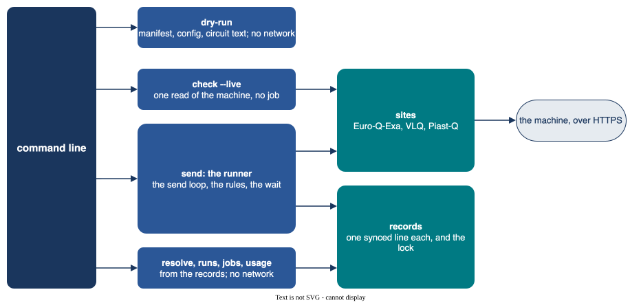

# eurohpc-qdevices user manual

Use `eurohpc-qdevices` to send a fixed list of circuits to a EuroHPC quantum computer, one job at a time,
with an exact record of what was sent and what came back. It is for holders of a EuroHPC quantum award,
on a laptop or a login node:

- **Euro-Q-Exa** at LRZ, through the Munich Quantum Portal;
- **VLQ** at IT4Innovations, through LEXIS and HEAppE;
- **Piast-Q** at PCSS, through the PCSS broker.

:::{seealso}
**To get onto the machines**, follow the ENCCS lesson
[EuroHPC JU quantum devices and HPC-QC access in practice](https://enccs.github.io/eurohpc-quantum-devices-access-hpcqc/):
applying, onboarding at each site, and a first job on each machine. This manual covers the app only.
:::

Package `eurohpc-qdevices`, import name `qdevices`, command `qdevices`. Start with {doc}`installing`, and
read {doc}`live-runs` before a live run.

**Status.** The app has run live on each of the three machines. The offline tests run against
fake sites.

## What it does, and what it does not

It reads a manifest, checks it offline, reads the state of a machine, sends the jobs in order with a record
synced to disk, collects jobs after a crash, records your decision on an order with `qdevices resolve`,
stops on rules, and shows runs, jobs and usage from the records.



It does not build, compile, emulate or change circuits: the text in the file is sent unchanged. It holds
no rule of an experiment: give those in a Python file. It never cancels a job, never sends a lost
submission again, and never stores or prints a token.

You need:

- a EuroHPC quantum award, and an account at the site of the machine (the
  [lesson](https://enccs.github.io/eurohpc-quantum-devices-access-hpcqc/onboarding/) shows how);
- circuits in the form the site takes: OpenQASM for Euro-Q-Exa and VLQ, the broker's operation list for
  Piast-Q;
- the command line, and [pixi](https://pixi.sh) or another Python package manager.

```{toctree}
:caption: Using the app
:maxdepth: 1

installing
commands
manifests-and-records
configuration
rules
live-runs
examples
qrisp
hamiltonian
billing-and-usage
```

```{toctree}
:caption: The sites
:maxdepth: 1

euroqexa
vlq
piastq
```

```{toctree}
:caption: Reference
:maxdepth: 1

references
```

ENCCS is the EuroCC National Competence Centre Sweden, part of the EuroCC 3 project (grant 101306701), with
partners Linköping University and RISE Research Institutes of Sweden. This manual is under
[CC BY-SA 4.0](https://creativecommons.org/licenses/by-sa/4.0/legalcode.en) (the file `LICENSE`). The code
of the app, and the code snippets in this manual, are under the
[MIT licence](https://github.com/ENCCS/eurohpc-qdevices/blob/main/LICENSE.code) (the file `LICENSE.code`).
