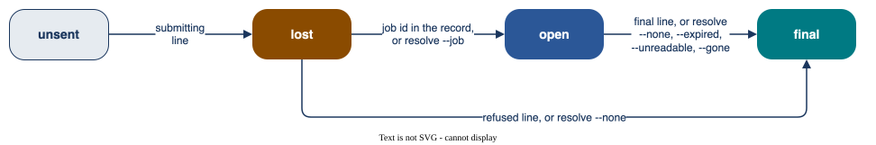

# Live runs

Read this page before a live run. It says how a job is never sent twice, never cancelled, and always in a
record.

## The record

Each event is one JSON line, written, flushed and synced to disk (`fsync`, and `F_FULLFSYNC` on macOS)
before the next request ({ref}`records`). A **"submitting"** line is on disk before the first request of a
job. Each step of a VLQ job (created, uploaded) is on disk before the next request. The job id is on disk
as soon as the answer is read.

| Order | In the record | What the app does |
|---|---|---|
| **lost** | a "submitting" line, no job id: the request may have reached the site | never sends it again; blocks a new run until you resolve it (below) |
| **open** | a job id, no result | a resume collects it and never sends it again; blocks a new run on its site until then |

**Never edit or move a record.** The budget and the open-order check read every record where it is. A copy
in another place sends nothing: a resume that sends takes only the newest record of its run folder, from
the host, path, device and inode in its start line. Read a record with `qdevices jobs RECORD` or any JSON tool.

A resume never submits a VLQ job that has no "submitted" line. It reads the state of the job:

| State at the site | In the record | Result |
|---|---|---|
| past Configuring | any | collected |
| cannot be read | any | the order stays open; exit code 1 |
| Configuring | the "created" line, no "uploaded" line | SubmitJob was never sent: a final "not submitted" line, no device time |
| Configuring | the "uploaded" line (written just before SubmitJob), or no "created" line | SubmitJob may have reached the site: the order stays open, nothing is cancelled or sent again; a stop `submit_unknown`, exit code 1. Check the job at the site. When it has left Configuring, a resume collects it. When the site shows it never ran: `qdevices resolve RECORD ORDER --none` |

## The answer to a job request

For VLQ, a job request is any request of the metered job. Each site page says which answer is a refusal.

| Answer | Result |
|---|---|
| a refusal: no job ran | the order is final, with a "refused" line; the rule `refusal` stops the run unless your `on_refusal` rule lets it go on |
| any other answer that is not a success: a redirect, 500 or more, a 4xx that is not a refusal at that site, no answer, no job id | a job may exist: a stop `unknown`, exit code 2; the order is never sent again. It is lost, or open when its job id is known (a VLQ job that was created) |
| a failure of the VLQ init job | a stop `prepare`, exit code 1; the order stays unsent |

- No transport retry. A request that makes a job is never sent twice: a network loss inside it leaves a
  lost order.
- In the wait, a failed read of the state or result (no answer, 500 or more, or the Piast-Q answer of too
  many connections) is a missed poll, asked again at the next poll until `wait_seconds`. When the wait ends
  with no good answer, or an answer ends it at once, the call stops (`status_error` or `result_error`). Its
  stop line holds `missed`: the kind of the last missed poll, or `null` when an answer ended the wait at once.
  The order stays open, and a resume collects it later. A result that still cannot be read is made final
  with `qdevices resolve RECORD ORDER --unreadable`: after two calls 10 minutes or more apart when the
  answer could not be used, else after two calls 24 hours or more apart ({ref}`resolving`).
- The wait for a VLQ init job ends at the first failed read (a stop `prepare`). The order stays unsent. A
  resume with `--max-order` makes a new init job.
- A line `RECORD WRITE FAILED (...): order N (NAME), job ID: ...` or `Under way at the stop: ...` gives the
  id of the job or init job under way. That id may not be in the record: write it down. When
  `qdevices jobs RECORD` shows the order as lost, give it with `qdevices resolve RECORD ORDER --job ID`.

## Nothing is cancelled

- The app has no cancel call. If you must, cancel a job at the site with its own tools. Then, if the
  record shows the order as lost, record what became of it with `qdevices resolve` (below).
- Ctrl-C, SIGTERM, SIGHUP and a wait time-out end the call with a "stop" line. The job runs on at the
  site. Collect it with `qdevices send MANIFEST --live --resume RECORD`. After an interrupt the call
  prints that command and `Under way at the stop: order N (NAME), job ID.` An error of the program (exit
  code 3) prints that line too.
- A signal set to ignore stays ignored, so `nohup` works. The screen never ends a live call: a closed pipe
  or terminal is passed over.
- Keep the machine awake (`caffeinate -i` on macOS). A sleep inside a request leaves a lost order.

(one-host)=

## One live call per site, from one host

`send`, `check --live`, `resolve` and `unlock` take the site lock, `~/.local/state/qdevices/<site>.lock`.

- A second live call on the site from this host is refused while the first runs: wait for it to end.
- `send` takes the lock before it reads any record. `resolve` reads the record to learn its site (for a
  record of another runner, the site whose `older_records` read it), takes the lock, reads it again and
  decides under the lock.
- The lock is an exclusive `flock` and a holder file `<site>.holder` (host name, pid, start time), as a
  cluster file system can grant a `flock` on each node with no error. A holder of another host refuses the
  call: check that host, then give `qdevices unlock SITE --host NAME`. A holder of this host whose process
  has ended is cleared. With no `flock` or no holder file, the call is refused: use a host whose home
  folder has `flock`.
- **Drive one site from one host.** A laptop and a login node have different home folders and do not see
  each other's lock or records. A resume that sends is refused on another host than the one that started
  the record. A resume without `--max-order` still collects there.
- The lock covers this app only: no other tool may send to the site during a live call. Records of another
  runner count in the budget and the open-order check only when listed in `older_records`
  ({doc}`configuration`).
- Keep the clock of the host synchronised (NTP). The records, job times and time rules read it.

(resolving)=

## Resolving an order, and a stale lock

`qdevices resolve RECORD ORDER OPTION` records your decision on one order, offline, in one synced line.
Find the order with `qdevices jobs RECORD`. In a record of this app it takes these cases, and refuses any
other:

| Order | Give | When | Then |
|---|---|---|---|
| lost | `--job ID` | you found the job in the job list of the site (Piast-Q has none: ask PCSS, {doc}`piastq`) | a resume collects it |
| lost | `--none` | the job list shows no job | final, with no job |
| open VLQ, last stop `submit_unknown` | `--none` | the site shows that the job never ran | final, with no job |
| open or lost, with a job id that no URL can hold (a newline in it) | `--job ID` with the id the site shows, or `--none` | no read of its state can name the job | with `--none`: final, counts at `job_seconds_limit`, as a job may exist |
| open, shown only as `New` (Piast-Q) | `--none` | every status line with a state says `New` (a missed poll is passed over), the first is 3 days old or more and the last at most 24 hours old: resume once more first | counts at `job_seconds_limit`, as its job may still run |
| open, last stop `result_expired` (Piast-Q) | `--expired` | two calls 10 minutes or more apart got that answer | final, counts at `job_seconds_limit` |
| open, last stop `result_error`: the job finished, and its result cannot be read | `--unreadable` | two calls 10 minutes or more apart got an answer that could not be used, or two calls 24 hours or more apart got that stop (below) | final, counts at `job_seconds_limit` |
| final, the result has more seconds than `job_seconds_limit` | `--over-limit` | the time is a wait at the site, cause not known, not the run of the job | counts at `job_seconds_limit`; the measured seconds stay in the record |

For `--unreadable`, an answer that could not be used is a `result_error` stop with `missed` `null` and no
`http_status` of 300 or more. Any other `result_error` stop got no usable answer: missed polls up to
`wait_seconds`, a redirect or an HTTP error of 400 or more, or a stop line of qdevices before 0.2.0, which
has no `missed`. The stop says how far apart the two calls must be, and names the command. A record with an
`--unreadable` decision needs qdevices 0.2.0 or later; an older app reads the order as open and refuses new
sends of that site.

The app never sends a resolved order again, and never cancels the job at the site. For an open order that
`resolve` does not take, ask the site (each site page gives its support), and resume once the job is final.

**A record of another runner is never written.** That is a record whose first start line this app did
not write, and which is not in the records folder of the app.

- `resolve` takes it only when its first line is a start line (settle any other with its runner), and the
  app reads it for its own site: list it, or its folder, in `older_records` of that site, or of one site
  only when its site cannot be told ({doc}`configuration`). Else the decision has no effect.
- The decision goes to `older_decisions.jsonl` of that site, in one synced line under its lock
  ({doc}`manifests-and-records`). It holds only while the order is as it was decided on: a job id, new job
  or result that the other runner writes later stands. A send reads only the decisions of its own site.
- It takes `--none` for a lost order (final, with no job), `--gone` for an open order whose job the site
  no longer gives (final, counts at `job_seconds_limit`), and `--over-limit` as above.
- It refuses `--job`, `--expired` and `--unreadable`: the app does not collect such a record, so collect
  it with its runner. `--gone` on a record of this app is refused: there, `--expired` takes such an order.

(tokens)=

## Tokens

- The token is read once from one environment variable (`MQSS_TOKEN`, `LEXIS_TOKEN`, `PCSS_API_KEY`).
  The variable is then deleted from the process environment, before a rules file is imported ({doc}`rules`).
- The app reads no token file, and never stores or prints a token.
- Never type the token on the command line. Use `set +x; export NAME="$(cat FILE)"`: then it is not in your
  shell history or a trace.
- The token goes only to the fixed addresses of the site, with no redirect. No flag and no environment
  variable moves them.
- A filter cleans every record line, error, downloaded log and traceback. It takes out the token and the
  VLQ envelope passwords of the call (each password raw and in base64), each whole, in JSON form and by
  every start and every end of 8 characters or more; any text in the form of a JWT; the value of
  `USER_JWT_PWD` (the envelope password in the environment of a VLQ job) in any form; and Fernet text and
  its base64 form.

## Budget and rules

The generic rules check the shots, the budget and more before each job, and the result after it
({doc}`rules`). The budget counts a lost or open order at `job_seconds_limit`, so the sum is an upper bound
({doc}`billing-and-usage`).
