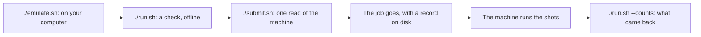

# Examples

Each folder explains itself. Go into it, read its `README.md`, and run its scripts, which use `tools/` of the clone. You can emulate every example with no account and no token: your computer computes what the machine would do. Words with a special meaning on these pages are defined under [Words used here](#words-used-here).

## Emulate them

**In your browser**, with nothing to install:

[](https://mybinder.org/v2/gh/ENCCS/eurohpc-qdevices/main?urlpath=lab/tree/examples/all_examples.ipynb) all the examples, side by side with what the machines gave

[](https://mybinder.org/v2/gh/ENCCS/eurohpc-qdevices/main?urlpath=lab/tree/examples/hamiltonian/tutorial.ipynb) the Hamiltonian simulation tutorial

[](https://mybinder.org/v2/gh/ENCCS/eurohpc-qdevices/main?urlpath=lab/tree/examples/hamiltonian/two_spins/two_spins.ipynb) two spins in a field: the short start to Hamiltonian simulation

Each opens in JupyterLab, where File > New > Terminal gives a terminal: `cd examples/qrisp/bell && ./emulate.sh`
runs an example there as on your own computer.

**On your own computer**, in a clone of this repository, with Python 3.8 or later or [pixi](https://pixi.sh):

```bash
git clone --depth 1 https://github.com/ENCCS/eurohpc-qdevices
cd eurohpc-qdevices/examples/qrisp/bell
./emulate.sh
```

On Windows, with Python and no bash: `python examples\tools\emulate.py examples\qrisp\bell\manifest.json`.

`./open.sh` here and in `hamiltonian/` opens the same pages on your own computer.

## Where to start

- **To learn Hamiltonian simulation in short:** [`hamiltonian/two_spins/`](hamiltonian/two_spins/README.md) is the short start: two spins in a field, solved in QuTiP, written as gates, built in Qrisp and run on Euro-Q-Exa, in one notebook.
- **To learn more, or to show it in a talk:** [`hamiltonian/`](hamiltonian/README.md) is a full tutorial, from the Schrödinger equation to a job on a quantum computer and on to the hydrogen molecule. You run it on the machine, and anyone can emulate it.
- **To see many algorithms:** [`qrisp/`](qrisp/README.md) has 16 programs, from a Bell pair to Grover's search.
- **To see the smallest job of each machine:** `euroqexa-one-qubit`, `vlq-one-qubit` or `piastq-one-qubit`.

## The folders

| Folder | Machine | What it does | Jobs |
|---|---|---|---|
| [`hamiltonian/`](hamiltonian/README.md) | Euro-Q-Exa | the short start, two spins in a field (`two_spins/`), and the tutorial: one excitation crossing three qubits | 2 in `two_spins/`; 11, and 1 for a talk |
| [`qrisp/`](qrisp/README.md) | Euro-Q-Exa | 16 programs written in Qrisp, one folder each | 1 each |
| [`euroqexa-one-qubit`](euroqexa-one-qubit/README.md) | Euro-Q-Exa | one X gate | 1 |
| [`euroqexa-bell`](euroqexa-bell/README.md) | Euro-Q-Exa | a Bell pair | 1 |
| [`euroqexa-ghz`](euroqexa-ghz/README.md) | Euro-Q-Exa | a GHZ state of three qubits | 1 |
| [`euroqexa-inverse`](euroqexa-inverse/README.md) | Euro-Q-Exa | a circuit and its inverse | 1 |
| [`euroqexa-three-jobs`](euroqexa-three-jobs/README.md) | Euro-Q-Exa | three jobs in one manifest, sent in stages | 3 |
| [`vlq-one-qubit`](vlq-one-qubit/README.md) | VLQ | one rotation | 1 |
| [`vlq-bell`](vlq-bell/README.md) | VLQ | a Bell pair in the machine's own gates | 1 |
| [`vlq-ghz`](vlq-ghz/README.md) | VLQ | a GHZ state of five qubits | 1 |
| [`piastq-one-qubit`](piastq-one-qubit/README.md) | Piast-Q | one rotation | 1 |
| [`piastq-bell`](piastq-bell/README.md) | Piast-Q | a Bell pair from one native gate | 1 |
| [`piastq-native`](piastq-native/README.md) | Piast-Q | the three native operations | 1 |

## What every folder holds

| File | What it is |
|---|---|
| `README.md` | what the example does, with a block diagram, and how to run it |
| `emulate.sh` | emulates it on your computer: `./emulate.sh`; nothing is sent |
| `run.sh` | checks it offline for a real send: `./run.sh`; also `./run.sh --login` and `./run.sh --counts` |
| `submit.sh` | sends it to the machine: `./submit.sh`; this needs your own account |
| `manifest.json` | what to send: the site, your project, and for each job its file, its SHA-256 and its shots |
| a `.qasm` or `.json` file | the circuit, in the form the site takes |
| `qrisp_emulated.json` | the share of each key on Qrisp's emulator, stored, with the version of Qrisp |
| `qutip_emulated.json` | the share of each key on QuTiP, with no noise, stored, with the versions of QuTiP and qutip-qip |
| `emulate_qutip.py` | the example in QuTiP code, gate by gate, to read; `python emulate_qutip.py` prints what QuTiP gives, where QuTiP and qutip-qip are installed |
| `emulate_qrisp.py` | the example in Qrisp code, gate by gate, to read; `python emulate_qrisp.py` prints what Qrisp's emulator gives, where Qrisp is installed |
| `circuit.png` | the circuit of one job, drawn by qutip-qip: the first, or the one the README names; the README shows it |
| `outcomes.png` | the share of each key from each source, as bars; the README shows it |
| `results.json` | the counts of one run on the machine, if it has run |

`./emulate.sh` runs our emulator (`tools/emulate.py`), in Python's standard library alone, and prints beside it the
stored results of Qrisp's emulator (`tools/qrisp_emulator.py`) and of QuTiP through its quantum information processing
package qutip-qip, gate by gate on a state vector (`tools/qutip_emulator.py`), so it needs neither. Neither is run
with noise here, and `--noise` and `--readout` are ours alone (`tools/circuit.py`). All three take the gates as
`tools/texts.py` reads the text; QuTiP and Qrisp do not read the text themselves. The same gates, written out as code,
are each folder's `emulate_qutip.py` and `emulate_qrisp.py` (`tools/write_qutip_scripts.py`,
`tools/write_qrisp_scripts.py`).

## After a change

After a change to a text, the stored results, the two scripts and the pictures of its folder still show the old
circuit. Where code writes the text, run that code first, as the folder's README says. Then, from the top of the
clone, make the files again, in this order, with the folder, or with none for every folder:

```bash
pixi run --manifest-path examples/qrisp/pixi.toml qutip-emulated examples/qrisp/bell
pixi run --manifest-path examples/qrisp/pixi.toml qrisp-emulated examples/qrisp/bell
pixi run --manifest-path examples/qrisp/pixi.toml qutip-scripts examples/qrisp/bell
pixi run --manifest-path examples/qrisp/pixi.toml qrisp-scripts examples/qrisp/bell
pixi run --manifest-path examples/qrisp/pixi.toml pictures examples/qrisp/bell
```

`pictures` comes last: it draws from the stored files. `results.json` stays the run of the old text. If you have sent
a job of the folder, give `manifest.json` a `"run"` name of its own before you send the changed text: without
`--new-run`, the app starts no new record of a run that has sent a job, and `./submit.sh` takes no `--new-run`.

## Write a circuit without writing OpenQASM

Write it in Python, in QuTiP or in Qrisp, as each folder's `emulate_qutip.py` and `emulate_qrisp.py` do, and let code
write the OpenQASM 2 text. In a folder for Euro-Q-Exa, which compiles the text it gets:

```bash
python emulate_qutip.py --qasm              # the text that qutip-qip writes from each circuit
python emulate_qrisp.py --qasm BELL > mine.qasm   # one job's text, as examples/qrisp/qasm2.py writes it from Qrisp
```

Keep one job in a file, as the second line does, put its name and SHA-256 in `manifest.json`, and `./run.sh` checks it
before a send. qutip-qip 0.4.2 writes no H or CZ and drops the semicolon after each measurement; `to_qasm` in each
script works round that, and its docstring names other gates that qutip-qip refuses. The Qrisp examples were written
this way: in `qrisp/bell`, `python emulate_qrisp.py --qasm` gives the bytes of its `BELL.qasm`. VLQ takes OpenQASM 3
in its own gates and Piast-Q the broker's list, so in their folders `--qasm` stops and says what the site takes.

## What happens



Only the first step is for everyone. The others need an account at the site, which is personal: never hand a token to anyone else. The [ENCCS lesson](https://enccs.github.io/eurohpc-quantum-devices-access-hpcqc/) says how to get one, and the [manual](https://enccs.github.io/eurohpc-qdevices/) covers the app.

## Words used here

- **emulate:** a classical computer computes what the machine would do with a text.
- **shot:** one run of the circuit, ending in one reading of the qubits.
- **key:** the bit string of one shot. In an OpenQASM text the highest classical bit is on the left, so `011` means classical bits 0 and 1 read 1. On Piast-Q, qubit 0 is on the left.
- **share:** the fraction of shots with a key.
- **text:** the circuit file that is sent.
- **OpenQASM:** a plain text that lists a circuit's gates, one per line; Euro-Q-Exa takes version 2, VLQ version 3.
- **SHA-256:** a fingerprint of a file, 64 characters long; `manifest.json` holds it, and the app sends a file only if the two agree.
- **shot error:** the spread that a finite number of shots gives: about sqrt(p(1 - p)/N) for a share p of N shots.
- **CX:** the controlled NOT: it flips its second qubit when the first is 1. QuTiP calls it CNOT.
- **broker:** the PCSS service in front of Piast-Q, which takes its jobs.
- **site:** the centre that runs the machine (LRZ, IT4Innovations, PCSS).
- **order:** the place of a job in `manifest.json`.
- **read of the machine:** asking the site for its state, with no job.
- **record:** the file on your disk with each step of a send.
- **award:** your project's machine time.
- **compile:** the site turns the text into the machine's own gates, and may change them.

## The files here

- `all_examples.ipynb` and `open.sh`: the page with all the examples, and what opens it.
- `qdevices.toml`: the example config. `./run.sh` uses it for its dry run while the manifest says MY-PROJECT. For a live run, copy it to `~/.config/qdevices/qdevices.toml`, where the app reads it, and put your own names in it.
- `rules_bell.py`: an example rules file, with a rule that judges a result and can stop a run ([the manual's page](https://enccs.github.io/eurohpc-qdevices/rules/)).
- `tools/`: what serves the folders: `emulate.py` runs the emulator, `*_one.sh` are the models of the scripts, and `folders.py` writes the READMEs of the folders written by hand.
