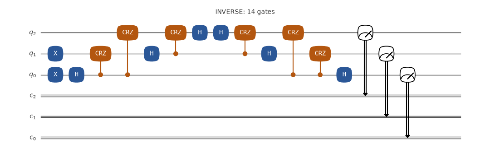
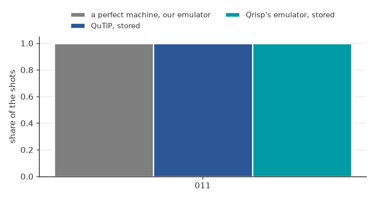
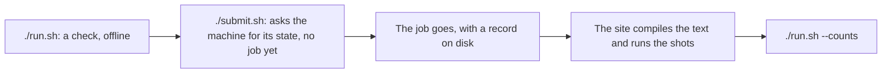

# A circuit and its inverse on Euro-Q-Exa

Prepare `011`, apply H and controlled RZ gates, then their inverse. A perfect machine undoes the whole middle, so no emulator is needed to know the answer. The site's compile may remove the middle: its job page on the portal shows what ran.




The circuit of the job as its file has it, drawn by qutip-qip: one-qubit gates in blue, two-qubit gates in orange, then the measurements. Its title names the job and says if anything is left out.



The share of each key, up to six keys and then the rest as other, from each source: a perfect machine (our emulator), QuTiP, Qrisp's emulator.

**What a perfect machine gives:** `011` every time: q[0] and q[1] read 1. A key reads q[2] q[1] q[0].

**What came back:** Not sent yet with this app.

## Emulate it

Your computer computes what the machine would do: no account, no token, and nothing is sent. On your own computer:

```bash
git clone --depth 1 https://github.com/ENCCS/eurohpc-qdevices
cd eurohpc-qdevices/examples/euroqexa-inverse
./emulate.sh
```

It prints what a perfect machine gives, then the stored results of Qrisp's emulator and of QuTiP, with no noise, then what the machine gave if this example has run. Add a simple model of noise, which is ours and not a model of any machine, with `./emulate.sh --noise 0.03 --readout 0.03`. It needs Python 3.8 or later, or [pixi](https://pixi.sh).

Or in your browser, with nothing to install: [](https://mybinder.org/v2/gh/ENCCS/eurohpc-qdevices/main?urlpath=lab/tree/examples/all_examples.ipynb). The first start can take some minutes. That page holds all the examples: put `euroqexa-inverse` in `NAME` under Choose one. Binder opens JupyterLab, where File > New > Terminal gives a terminal at the top of the clone: `cd examples/euroqexa-inverse && ./emulate.sh` runs this example there as on your own computer.

`emulate_qutip.py` and `emulate_qrisp.py` are this example in QuTiP code and in Qrisp code, gate by gate, to read. Run in this folder, each prints what its emulator gives, with no noise: `python emulate_qutip.py` where QuTiP and qutip-qip are installed, `python emulate_qrisp.py` where Qrisp is, as on Binder. From the top of a clone of your own, on Linux x86-64 or an Apple Silicon Mac: `pixi run --manifest-path examples/qrisp/pixi.toml python examples/euroqexa-inverse/emulate_qutip.py`, and the same with `emulate_qrisp.py`; the first run installs QuTiP and Qrisp, about 1 GB.

No need to write OpenQASM yourself: write the circuit in QuTiP or in Qrisp, as these two files do, and `--qasm` prints its OpenQASM 2 text for Euro-Q-Exa, which compiles it. In this folder, `python emulate_qutip.py --qasm INVERSE > mine.qasm`, or the same with `emulate_qrisp.py`, puts the text of the job INVERSE in `mine.qasm`. With pixi, run `pixi run --manifest-path examples/qrisp/pixi.toml python examples/euroqexa-inverse/emulate_qutip.py --qasm INVERSE > examples/euroqexa-inverse/mine.qasm` from the top of the clone, then come back here. To send it, put `mine.qasm` and its SHA-256 in `manifest.json` in place of the file and the SHA-256 of that job (`shasum -a 256 mine.qasm` on a Mac, `sha256sum mine.qasm` on Linux).

## Send it to the machine

This part is for people with an account at the site, and it uses their award.



1. Run `./run.sh`: a dry run, with no token, that sends nothing. It needs [pixi](https://pixi.sh), on Linux x86-64 or an Apple Silicon Mac, and a clone of the repository. It checks against `examples/qdevices.toml` while the manifest says `MY-`, then against your config, and it counts each measurement as a gate.
2. The first time, from the top of the clone: `mkdir -p ~/.config/qdevices && cp examples/qdevices.toml ~/.config/qdevices/qdevices.toml`. The app reads its settings there. Put your own names in that copy and in `manifest.json` here, in place of `MY-PROJECT`.
3. Set your token, which is never printed: `set +x; export MQSS_TOKEN="$(cat FILE)"`, where FILE is the file that holds your token. `./run.sh --login` says how to get one. A token is personal: never hand it to anyone else.
4. Run `./submit.sh`. It reads the machine once, sends the job, waits for it, and stores the counts in a record.
5. Run `./run.sh --counts` to see what came back.

## The files

| File | What it is |
|---|---|
| `INVERSE.qasm` | the circuit in OpenQASM 2; the site compiles it |
| `manifest.json` | what to send: the site, your project, and for each job its file, its SHA-256 and its shots |
| `emulate.sh` | emulates the example; nothing is sent |
| `qrisp_emulated.json` | the share of each key on Qrisp's emulator, stored, so `./emulate.sh` needs no Qrisp |
| `qutip_emulated.json` | the share of each key on QuTiP, with no noise, stored, so `./emulate.sh` needs no QuTiP |
| `emulate_qutip.py` | this example in QuTiP code, gate by gate; running it prints what QuTiP gives |
| `emulate_qrisp.py` | this example in Qrisp code, gate by gate; running it prints what Qrisp's emulator gives |
| `circuit.png` | the picture of the circuit above, drawn by qutip-qip |
| `outcomes.png` | the chart of the outcomes above |
| `run.sh` | checks the example offline for a real send; also `--login` and `--counts` |
| `submit.sh` | sends the example to the machine |

From the MQSS adapter example `examples/inverse_unitary_test.py`, Apache-2.0, with its loop written out. Each text here is written by hand: to change one, edit it and put its new SHA-256 in `manifest.json`, in each job that names it (`shasum -a 256 FILE` on a Mac, `sha256sum FILE` on Linux); the page of the site in the manual, linked below, says what the site takes. After a change, the stored results, the two scripts and the pictures here still show the old circuit: [After a change](../README.md#after-a-change) says how to make them again.

More: the [Euro-Q-Exa page](https://enccs.github.io/eurohpc-qdevices/euroqexa/) of the manual.
