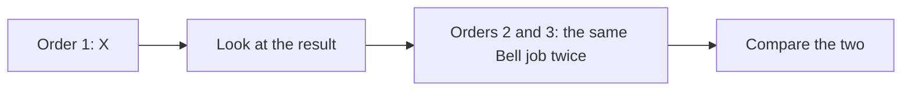
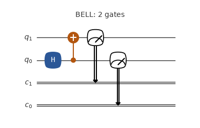
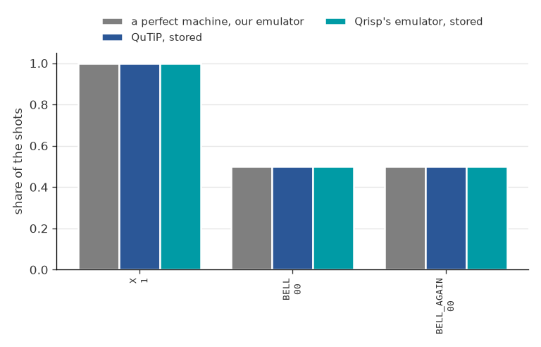
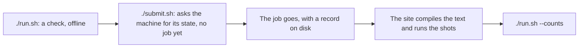

# Three jobs in one manifest

The X job, the Bell job, and the same Bell job again. It shows how a list of jobs runs in stages, and the Bell job sent twice shows the spread between two jobs of the same text.





The circuit of the job BELL as its file has it, drawn by qutip-qip: one-qubit gates in blue, two-qubit gates in orange, then the measurements. Its title names the job and says if anything is left out.



The share of the key a perfect machine gives most, for each job, from each source: a perfect machine (our emulator), QuTiP, Qrisp's emulator.

**What a perfect machine gives:** `1` every time for X; `00` and `11`, about half each, for each Bell job.

**What came back:** Not sent yet with this app.

## Emulate it

Your computer computes what the machine would do: no account, no token, and nothing is sent. On your own computer:

```bash
git clone --depth 1 https://github.com/ENCCS/eurohpc-qdevices
cd eurohpc-qdevices/examples/euroqexa-three-jobs
./emulate.sh
```

It prints what a perfect machine gives, then the stored results of Qrisp's emulator and of QuTiP, with no noise, then what the machine gave if this example has run. Add a simple model of noise, which is ours and not a model of any machine, with `./emulate.sh --noise 0.03 --readout 0.03`. It needs Python 3.8 or later, or [pixi](https://pixi.sh).

Or in your browser, with nothing to install: [](https://mybinder.org/v2/gh/ENCCS/eurohpc-qdevices/main?urlpath=lab/tree/examples/all_examples.ipynb). The first start can take some minutes. That page holds all the examples: put `euroqexa-three-jobs` in `NAME` under Choose one. It opens in JupyterLab, where File > New > Terminal gives a terminal: `cd examples/euroqexa-three-jobs && ./emulate.sh` runs this example there as on your own computer.

## Send it to the machine

This part is for people with an account at the site, and it uses their award.



1. Run `./run.sh`: a dry run, with no token, that sends nothing. It needs [pixi](https://pixi.sh), on Linux x86-64 or an Apple Silicon Mac, and a clone of the repository. It checks against `examples/qdevices.toml` while the manifest says `MY-`, then against your config, and it counts each measurement as a gate.
2. The first time, from the top of the clone: `mkdir -p ~/.config/qdevices && cp examples/qdevices.toml ~/.config/qdevices/qdevices.toml`. The app reads its settings there. Put your own names in that copy and in `manifest.json` here, in place of `MY-PROJECT`.
3. Set your token, which is never printed: `set +x; export MQSS_TOKEN="$(cat FILE)"`, where FILE is the file that holds your token. `./run.sh --login` says how to get one. A token is personal: never hand it to anyone else.
4. Run `./submit.sh`. It reads the machine once and sends order 1 alone, so you can look at it first. It then prints `Go on with: qdevices send ... --max-order N`. Start `pixi shell` at the top of the clone, come back here, and run that line with N = 3; no order goes twice.
5. Run `./run.sh --counts` to see what came back.

## The files

| File | What it is |
|---|---|
| `X.qasm` | the circuit in OpenQASM 2; the site compiles it |
| `BELL.qasm` | the circuit in OpenQASM 2; the site compiles it |
| `manifest.json` | what to send: the site, your project, and for each job its file, its SHA-256 and its shots |
| `emulate.sh` | emulates the example; nothing is sent |
| `qrisp_emulated.json` | the share of each key on Qrisp's emulator, stored, so `./emulate.sh` needs no Qrisp |
| `qutip_emulated.json` | the share of each key on QuTiP, with no noise, stored, so `./emulate.sh` needs no QuTiP |
| `circuit.png` | the picture of the circuit above, drawn by qutip-qip |
| `outcomes.png` | the chart of the outcomes above; from the top of the clone, `pixi run --manifest-path examples/qrisp/pixi.toml pictures` draws both again |
| `run.sh` | checks the example offline for a real send; also `--login` and `--counts` |
| `submit.sh` | sends the example to the machine |

The text is written by hand, in OpenQASM 2; the site compiles it. To change it, edit the text and put its new SHA-256 in `manifest.json` (`shasum -a 256 FILE` on a Mac, `sha256sum FILE` on Linux); the page of the site in the manual, linked below, says what the site takes.

More: the [Euro-Q-Exa page](https://enccs.github.io/eurohpc-qdevices/euroqexa/) of the manual.
