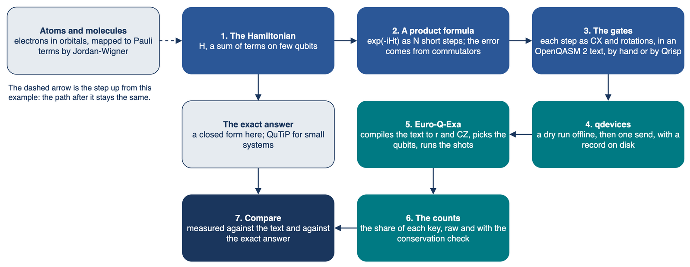
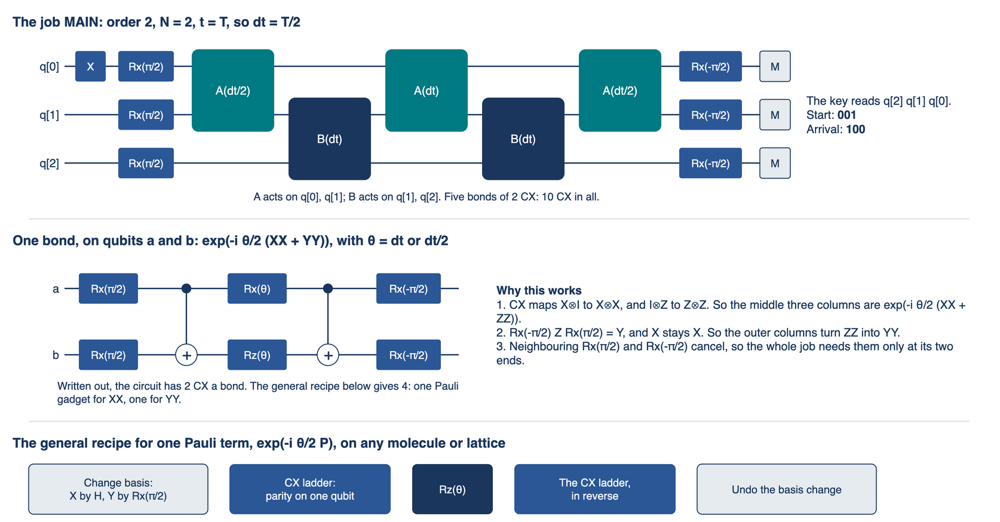

# Hamiltonian simulation, step by step

[](https://mybinder.org/v2/gh/ENCCS/eurohpc-qdevices/main?urlpath=doc/tree/examples/hamiltonian/tutorial.ipynb)

A worked example from the Schrödinger equation to a quantum computer. One excitation crosses three qubits under `H = (1/2) sum (XX + YY)`. We compute the exact answer, write the evolution as a circuit, run it on Euro-Q-Exa, compare the counts with the exact answer, follow the same path to the hydrogen molecule, and compare its whole dissociation curve with FCI in several bases and the published exact values.

**New to this? Start with [`two_spins/`](two_spins/README.md)**: two spins in a field, the same path in one short notebook, from QuTiP to the gates, Qrisp and a run on Euro-Q-Exa.

**The tutorial is [`tutorial.ipynb`](tutorial.ipynb).** The jobs run on the quantum computer. To try them yourself, click the button above: the page emulates them, with no account and no token, and nothing is sent. To read it with no click at all, open [its page in the manual](https://enccs.github.io/eurohpc-qdevices/hamiltonian/).

Two words, as used here. *Hamiltonian simulation* is what the quantum computer does: it applies the evolution of a physical system to its qubits. *Emulation* is what your computer does: it computes what the quantum computer would do with the same circuit.



## The main result

The same evolution, at the same time `T`, with more and more Trotter steps. One run, on one evening: it shows how much of the answer survived that evening, not how good the machine is.

| Trotter steps `N` | 1 | 2 | 4 | 8 |
|---|---|---|---|---|
| Two-qubit gates in the text | 6 | 10 | 18 | 34 |
| A perfect machine, share of the arrival key `100` | 0.508 | 0.970 | 0.998 | 1.000 |
| Euro-Q-Exa, all shots | 0.381 | 0.641 and 0.661 | 0.474 | 0.190 |
| Euro-Q-Exa, with the conservation check | 0.465 | 0.908 and 0.892 | 0.829 | 0.490 |

Too few steps and the formula is wrong. Too many and the gates lose the answer. The tutorial explains each number.



## Run it on the quantum computer

This is for the speaker, who has an account at the site. [`live/`](live/README.md) holds one job, MAIN, so one command runs it. From the top of a clone:

```bash
pixi run --manifest-path examples/qrisp/pixi.toml hamiltonian --project YOURS --out my-chain   # once: your own copy, which git ignores
set +x; export MQSS_TOKEN="$(cat FILE)"                 # FILE holds your token, which is never printed
my-chain/live/run.sh                                    # a dry run, offline
my-chain/live/submit.sh                                 # one read of the machine, then the job; it waits for the counts
pixi run python examples/hamiltonian/compare.py --live  # the table, and live.json for the tutorial
examples/hamiltonian/open.sh                            # the tutorial: Run All Cells now reads your counts
```

The app refuses a second send from one folder; the README of `live/` gives the line for a new job. [`state_transfer/`](state_transfer/README.md) holds all eleven jobs, sent in the same way, in stages.

## Try it yourself: emulate it

No account and no token. In your browser, the button above. On your own computer:

```bash
git clone https://github.com/ENCCS/eurohpc-qdevices
cd eurohpc-qdevices/examples/hamiltonian
./open.sh                                  # opens the tutorial; it needs pixi (https://pixi.sh)
cd live && ./emulate.sh                    # the job of the talk: a perfect machine, Qrisp, QuTiP, the machine
./emulate.sh --noise 0.03 --readout 0.03   # the same with a simple model of noise; it is not a model of the machine
cd ../state_transfer && ./emulate.sh       # all eleven jobs
```

Beside ours, `./emulate.sh` prints the stored shares of Qrisp's emulator and of a third emulator, QuTiP, which runs the same text gate by gate through its package qutip-qip with no noise; `pixi run --manifest-path examples/qrisp/pixi.toml qutip-emulated`, from the top of a clone, makes its `qutip_emulated.json` files again.

With no pixi, `./emulate.sh` still works with Python alone; and `pip install jupyterlab numpy scipy matplotlib qutip qutip-qip`, then `jupyter lab tutorial.ipynb`, opens the tutorial.

## With an audience

You run the job on the machine, and anyone who wants to try emulates it: one click, with no account and no token.

- Before a talk, put a tag on the repository, use the tag in the Binder link in place of `main`, and open that link once. Binder builds an image for each new commit, and a tag does not move.
- To give people your counts, put `live.json` at a public link. They paste the link into `COUNTS` in the tutorial, and their page reads your counts.
- Never hand out a token, even a short-lived one: it acts fully as you. Binder also cannot reach the portal of the machine.

## The files

| File or folder | What it is |
|---|---|
| `tutorial.ipynb` | the tutorial |
| `open.sh` | opens the tutorial on your own computer |
| `two_spins/` | the short start: two spins in a field, one notebook, and two jobs with their own README and scripts |
| `live/` | the job for a talk, with its own README, `emulate.sh`, `run.sh`, `submit.sh`, `results.json`, `qrisp_emulated.json`, `qutip_emulated.json`, and the pictures `circuit.png` and `outcomes.png` |
| `state_transfer/` | the eleven jobs, as they were sent, with the same files |
| `chain.py` | the model, its closed form, and the Trotter steps as a text |
| `matrices.py` | the same as matrices: exact evolution, product formulas, Jordan-Wigner |
| `tables.py`, `figures.py`, `figs/` | the tables and charts; the block diagrams, each with its `.drawio` source |
| `reading.py`, `compare.py` | the counts of a run as shares; a record compared with the exact answer |
| `hydrogen.py`, `with_qrisp.py` | the hydrogen molecule; what the tutorial does with Qrisp |
| `molecule.py`, `integrals.py` | H2 in STO-3G from first principles; phase estimation of it in closed form |
| `reference.py`, `reference_curve.json` | the stored curves: PySCF's, the published ones, and one emulated run |
| `exact_chemistry.py` | makes PySCF's curves, with `pixi exec` |
| `curve_checks.md` | the checks behind the curve of H2 |
| `exact.py` | QuTiP against the closed form |
| `write_chain.py`, `chain_notes.py` | write `live/` and `state_transfer/`; what their READMEs say |

More: the card [Hamiltonian simulation, P06](https://elhamkashefi.github.io/primitives-atlas/#P06) of the Quantum Algorithmic Primitives Atlas places this routine among the others.
