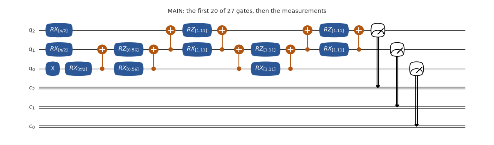
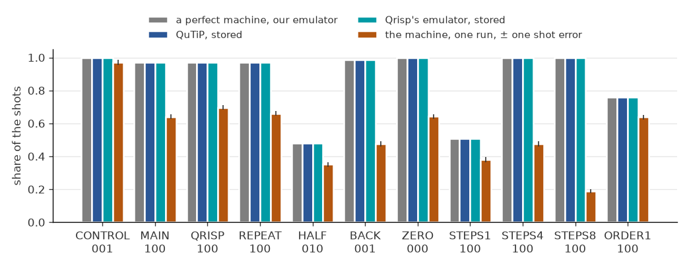
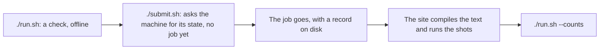

# The jobs of the Hamiltonian tutorial

The jobs of the tutorial in `examples/hamiltonian/`: start there. One excitation crosses three qubits under `H = (1/2) sum (XX + YY)`, and arrives in full at `T = pi/sqrt 2`. The jobs are CONTROL (no evolution), MAIN and QRISP (the same evolution as two texts), REPEAT (the text of MAIN again, to see how far two jobs of one circuit differ), HALF (at T/2), BACK (at 2T, when it has returned), ZERO (the same gates with no excitation), STEPS1, STEPS4, STEPS8 (other numbers of Trotter steps) and ORDER1 (first order).




The circuit of the job MAIN as its file has it, drawn by qutip-qip: one-qubit gates in blue, two-qubit gates in orange, then the measurements. Its title names the job and says if anything is left out.



The share of the key a perfect machine gives most, for each job, from each source: a perfect machine (our emulator), QuTiP, Qrisp's emulator, and one run on the machine, with a bar of one shot error each way.

**What a perfect machine gives:** `100` at 0.970 for MAIN, QRISP and REPEAT; `001` for CONTROL, and at 0.988 for BACK; `000` for ZERO. A key reads q[2] q[1] q[0]. `manifest.json` holds the shares of each job.

**What came back:** `100` in 641 of 1000 for MAIN, 661 for REPEAT, 696 for QRISP; 381, 474 and 190 for 1, 4 and 8 steps. The tutorial reads them all. One run, on one day: it shows how much of the answer survived that day, not how good the machine is.

## Emulate it

Your computer computes what the machine would do: no account, no token, and nothing is sent. On your own computer:

```bash
git clone --depth 1 https://github.com/ENCCS/eurohpc-qdevices
cd eurohpc-qdevices/examples/hamiltonian/state_transfer
./emulate.sh
```

It prints what a perfect machine gives, then the stored results of Qrisp's emulator and of QuTiP, with no noise, then what the machine gave if this example has run. Add a simple model of noise, which is ours and not a model of any machine, with `./emulate.sh --noise 0.03 --readout 0.03`. It needs Python 3.8 or later, or [pixi](https://pixi.sh).

Or in your browser, with nothing to install: [](https://mybinder.org/v2/gh/ENCCS/eurohpc-qdevices/main?urlpath=lab/tree/examples/all_examples.ipynb). The first start can take some minutes. That page holds all the examples: put `hamiltonian/state_transfer` in `NAME` under Choose one. It opens in JupyterLab, where File > New > Terminal gives a terminal: `cd examples/hamiltonian/state_transfer && ./emulate.sh` runs this example there as on your own computer.

## Send it to the machine

This part is for people with an account at the site, and it uses their award.



1. Run `./run.sh`: a dry run, with no token, that sends nothing. It needs [pixi](https://pixi.sh), on Linux x86-64 or an Apple Silicon Mac, and a clone of the repository. It checks against `examples/qdevices.toml` while the manifest says `MY-`, then against your config, and it counts each measurement as a gate.
2. The first time, from the top of the clone: `mkdir -p ~/.config/qdevices && cp examples/qdevices.toml ~/.config/qdevices/qdevices.toml`. The app reads its settings there. Put your own names in that copy and in `manifest.json` here, in place of `MY-PROJECT`.
3. Set your token, which is never printed: `set +x; export MQSS_TOKEN="$(cat FILE)"`, where FILE is the file that holds your token. `./run.sh --login` says how to get one. A token is personal: never hand it to anyone else.
4. Run `./submit.sh`. It reads the machine once and sends order 1 alone, so you can look at it first. It then prints `Go on with: qdevices send ... --max-order N`. Start `pixi shell` at the top of the clone, come back here, and run that line with N = 11; no order goes twice.
5. Run `./run.sh --counts` to see what came back.

## The files

| File | What it is |
|---|---|
| `*.qasm` | the circuit in OpenQASM 2; the site compiles it |
| `manifest.json` | what to send: the site, your project, and for each job its file, its SHA-256 and its shots |
| `emulate.sh` | emulates the example; nothing is sent |
| `qrisp_emulated.json` | the share of each key on Qrisp's emulator, stored, so `./emulate.sh` needs no Qrisp |
| `qutip_emulated.json` | the share of each key on QuTiP, with no noise, stored, so `./emulate.sh` needs no QuTiP |
| `circuit.png` | the picture of the circuit above, drawn by qutip-qip |
| `outcomes.png` | the chart of the outcomes above; from the top of the clone, `pixi run --manifest-path examples/qrisp/pixi.toml pictures` draws both again |
| `run.sh` | checks the example offline for a real send; also `--login` and `--counts` |
| `submit.sh` | sends the example to the machine |
| `results.json` | the counts of one run on the machine, with no job id and no date |

Written by `examples/hamiltonian/write_chain.py`. To change a job, change it there and run the script again.

More: the [Euro-Q-Exa page](https://enccs.github.io/eurohpc-qdevices/euroqexa/) of the manual.
