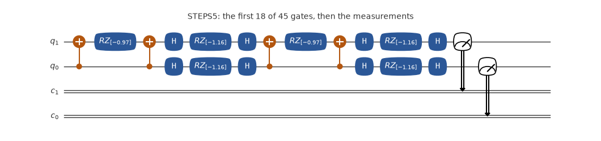
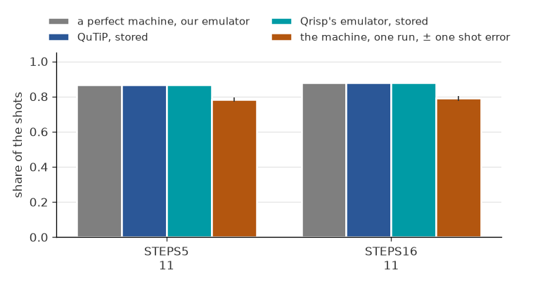
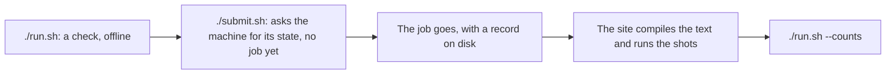

# Two spins in a field: the short start

[](https://mybinder.org/v2/gh/ENCCS/eurohpc-qdevices/main?urlpath=lab/tree/examples/hamiltonian/two_spins/two_spins.ipynb)

The short start to Hamiltonian simulation: one short notebook, [`two_spins.ipynb`](two_spins.ipynb). Two spins of the Ising model in a transverse field, `H = -Z0 Z1 - 1.2 (X0 + X1)`, start in `00` and evolve to `t = 2 pi/2.6`, a time at which `01` and `10` are zero and `11` holds 0.874. The notebook solves the model exactly in QuTiP, writes the evolution as Trotter steps of CX, RZ and H, builds the same circuit in Qrisp, and reads two runs on Euro-Q-Exa: 5 steps, and 16.

Why this model: it is a model of magnets such as LiHoF4 and CoNb2O6 in a field across their axis; quantum annealing changes its field over time; and one Trotter step, a short slice of the evolution written as gates, has the shape of one layer of QAOA, the quantum approximate optimisation algorithm. The notebook cites the papers. Two spins are solved exactly on any laptop, and the magnets, annealing and QAOA need many spins: the point here is to learn the steps that carry over. The [long tutorial](../tutorial.ipynb) goes on to three qubits and to the hydrogen molecule.




The circuit of the first job as its file has it, drawn by qutip-qip: one-qubit gates in blue, two-qubit gates in orange, then the measurements. Its title names the job and says if anything is left out.



The share of the key a perfect machine gives most, for each job, from each source: a perfect machine (our emulator), QuTiP, Qrisp's emulator, and one run on the machine, with a bar of one shot error each way.

**What a perfect machine gives:** `11` at 0.866 for STEPS5 and at 0.877 for STEPS16; with no Trotter error, 0.874. A key reads q[1] q[0]. At this time the exact evolution puts nothing on `01` and `10`; 5 steps put 0.013 on each.

**What came back:** 1000 shots each, from runs of these same texts; STEPS5 was sent as `qrisp/ising2`. STEPS5: `11`: 783, `00`: 95, `01`: 67, `10`: 55. STEPS16: `11`: 789, `00`: 113, `01`: 53, `10`: 45. The two read the same within the shot error, about 0.013, though STEPS16 has 32 CX in its text and STEPS5 has 10. On two qubits all the steps make one two-qubit block, which 2 CX can make, so the site's compile very likely merged them; the circuit that ran has not been read. One run, on one day: it shows how much of the answer survived that day, not how good the machine is.

## Emulate it

Your computer computes what the machine would do: no account, no token, and nothing is sent. On your own computer:

```bash
git clone --depth 1 https://github.com/ENCCS/eurohpc-qdevices
cd eurohpc-qdevices/examples/hamiltonian/two_spins
./emulate.sh
```

It prints what a perfect machine gives, then the stored results of Qrisp's emulator and of QuTiP, with no noise, then what the machine gave if this example has run. Add a simple model of noise, which is ours and not a model of any machine, with `./emulate.sh --noise 0.03 --readout 0.03`. It needs Python 3.8 or later, or [pixi](https://pixi.sh).

Or in your browser, with nothing to install: [](https://mybinder.org/v2/gh/ENCCS/eurohpc-qdevices/main?urlpath=lab/tree/examples/hamiltonian/two_spins/two_spins.ipynb), the notebook of this folder. The first start can take some minutes. [`all_examples.ipynb`](../../all_examples.ipynb) holds all the examples: put `hamiltonian/two_spins` in `NAME` under Choose one. Binder opens JupyterLab, where File > New > Terminal gives a terminal at the top of the clone: `cd examples/hamiltonian/two_spins && ./emulate.sh` runs this example there as on your own computer.

`emulate_qutip.py` and `emulate_qrisp.py` are this example in QuTiP code and in Qrisp code, gate by gate, to read. Run in this folder, each prints what its emulator gives, with no noise: `python emulate_qutip.py` where QuTiP and qutip-qip are installed, `python emulate_qrisp.py` where Qrisp is, as on Binder. From the top of a clone of your own, on Linux x86-64 or an Apple Silicon Mac: `pixi run --manifest-path examples/qrisp/pixi.toml python examples/hamiltonian/two_spins/emulate_qutip.py`, and the same with `emulate_qrisp.py`; the first run installs QuTiP and Qrisp, about 1 GB.

No need to write OpenQASM yourself: write the circuit in QuTiP or in Qrisp, as these two files do, and `--qasm` prints its OpenQASM 2 text for Euro-Q-Exa, which compiles it. In this folder, `python emulate_qutip.py --qasm STEPS5 > mine.qasm`, or the same with `emulate_qrisp.py`, puts the text of the job STEPS5 in `mine.qasm`; with no job name, `--qasm` prints the text of each job, after a line `// NAME`, to read: a file to send holds one job. With pixi, run `pixi run --manifest-path examples/qrisp/pixi.toml python examples/hamiltonian/two_spins/emulate_qutip.py --qasm STEPS5 > examples/hamiltonian/two_spins/mine.qasm` from the top of the clone, then come back here. To send it, put `mine.qasm` and its SHA-256 in `manifest.json` in place of the file and the SHA-256 of that job, and of each other job that names the same file (`shasum -a 256 mine.qasm` on a Mac, `sha256sum mine.qasm` on Linux).

## Send it to the machine

This part is for people with an account at the site, and it uses their award.



1. Run `./run.sh`: a dry run, with no token, that sends nothing. It needs [pixi](https://pixi.sh), on Linux x86-64 or an Apple Silicon Mac, and a clone of the repository. It checks against `examples/qdevices.toml` while the manifest says `MY-`, then against your config, and it counts each measurement as a gate.
2. The first time, from the top of the clone: `mkdir -p ~/.config/qdevices && cp examples/qdevices.toml ~/.config/qdevices/qdevices.toml`. The app reads its settings there. Put your own names in that copy and in `manifest.json` here, in place of `MY-PROJECT`.
3. Set your token, which is never printed: `set +x; export MQSS_TOKEN="$(cat FILE)"`, where FILE is the file that holds your token. `./run.sh --login` says how to get one. A token is personal: never hand it to anyone else.
4. Run `./submit.sh`. It reads the machine once and sends order 1 alone, so you can look at it first. It then prints `Go on with: qdevices send ... --max-order N`. Start `pixi shell` at the top of the clone, come back here, and run that line with N = 2; no order goes twice.
5. Run `./run.sh --counts` to see what came back.

## The files

| File | What it is |
|---|---|
| `STEPS5.qasm` | the circuit in OpenQASM 2; the site compiles it |
| `STEPS16.qasm` | the circuit in OpenQASM 2; the site compiles it |
| `manifest.json` | what to send: the site, your project, and for each job its file, its SHA-256 and its shots |
| `emulate.sh` | emulates the example; nothing is sent |
| `qrisp_emulated.json` | the share of each key on Qrisp's emulator, stored, so `./emulate.sh` needs no Qrisp |
| `qutip_emulated.json` | the share of each key on QuTiP, with no noise, stored, so `./emulate.sh` needs no QuTiP |
| `emulate_qutip.py` | this example in QuTiP code, gate by gate; running it prints what QuTiP gives |
| `emulate_qrisp.py` | this example in Qrisp code, gate by gate; running it prints what Qrisp's emulator gives |
| `circuit.png` | the picture of the circuit above, drawn by qutip-qip |
| `outcomes.png` | the chart of the outcomes above |
| `run.sh` | checks the example offline for a real send; also `--login` and `--counts` |
| `submit.sh` | sends the example to the machine |
| `results.json` | the counts of one run on the machine, with no job id and no date |
| `two_spins.ipynb` | the notebook: the model, the gates, Qrisp, the run, where the model is used, and what the run shows |
| `spins.py` | the model in QuTiP: its levels, the exact evolution, the Trotter steps, the chart |
| `by_qrisp.py` | the same in Qrisp: the function that writes the texts, and Qrisp's emulator |
| `trotter.py` | the steps as a text in Python alone, for other fields and steps |
| `machine.py` | the counts as shares with shot errors, and the simple model of the notebook |
| `write_two_spins.py` | writes this folder |

This folder is written by `write_two_spins.py`; its texts come from `ising2` in `examples/qrisp/programs.py`. To change a job, change it there and, from the top of the clone, run `pixi run --manifest-path examples/qrisp/pixi.toml two-spins`: a text changed by hand no longer matches its SHA-256. After a change, the stored results, the two scripts and the pictures here still show the old circuit: [After a change](../../README.md#after-a-change) says how to make them again.

More: the [Euro-Q-Exa page](https://enccs.github.io/eurohpc-qdevices/euroqexa/) of the manual.
