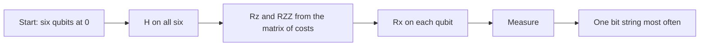
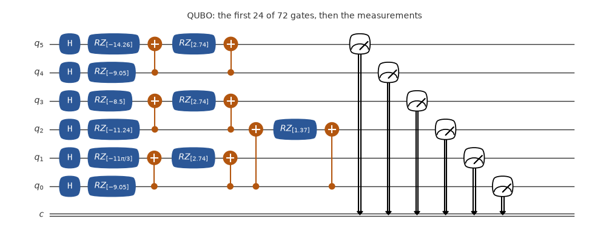
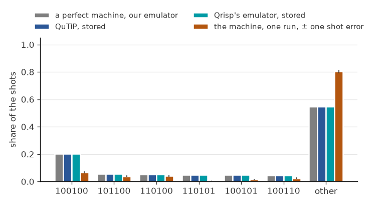
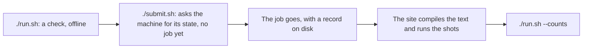

# One QAOA layer of a QUBO

An optimisation over six bits, with a matrix of costs, in one QAOA layer with fixed angles. One layer lowers the mean cost, but it does not peak at the best string.





The circuit of the job as its file has it, drawn by qutip-qip: one-qubit gates in blue, two-qubit gates in orange, then the measurements. Its title names the job and says if anything is left out.



The share of each key, up to six keys and then the rest as other, from each source: a perfect machine (our emulator), QuTiP, Qrisp's emulator, and one run on the machine, with a bar of one shot error each way.

**What a perfect machine gives:** 001001 most often, about 0.2. `./emulate.sh` and the site print keys, with the highest qubit on the left: 100100: 0.202  101100: 0.057  110100: 0.051  110101: 0.049  and 60 more. Qrisp's own labels, as a Qrisp program prints them, read q[0] first, so a label and its key can look reversed. The line of Qrisp's emulator in `./emulate.sh` is in keys.

**What came back:** 1000 shots: `100100`: 67 on top, then `110100`: 41. That key is the top of the ideal, at 0.20, with a cost of -17. The best string, `010001`, with a cost of -34, has an ideal share of 0.015 and read 19: one layer with fixed angles does not find it. One run, on one day: it shows how much of the answer survived that day, not how good the machine is.

## Emulate it

Your computer computes what the machine would do: no account, no token, and nothing is sent. On your own computer:

```bash
git clone --depth 1 https://github.com/ENCCS/eurohpc-qdevices
cd eurohpc-qdevices/examples/qrisp/qubo
./emulate.sh
```

It prints what a perfect machine gives, then the stored results of Qrisp's emulator and of QuTiP, with no noise, then what the machine gave if this example has run. Add a simple model of noise, which is ours and not a model of any machine, with `./emulate.sh --noise 0.03 --readout 0.03`. It needs Python 3.8 or later, or [pixi](https://pixi.sh).

Or in your browser, with nothing to install: [](https://mybinder.org/v2/gh/ENCCS/eurohpc-qdevices/main?urlpath=lab/tree/examples/all_examples.ipynb). The first start can take some minutes. That page holds all the examples: put `qrisp/qubo` in `NAME` under Choose one. It opens in JupyterLab, where File > New > Terminal gives a terminal: `cd examples/qrisp/qubo && ./emulate.sh` runs this example there as on your own computer.

## Send it to the machine

This part is for people with an account at the site, and it uses their award.



1. Run `./run.sh`: a dry run, with no token, that sends nothing. It needs [pixi](https://pixi.sh), on Linux x86-64 or an Apple Silicon Mac, and a clone of the repository. It checks against `examples/qdevices.toml` while the manifest says `MY-`, then against your config, and it counts each measurement as a gate.
2. The first time, from the top of the clone: `mkdir -p ~/.config/qdevices && cp examples/qdevices.toml ~/.config/qdevices/qdevices.toml`. The app reads its settings there. Put your own names in that copy and in `manifest.json` here, in place of `MY-PROJECT`.
3. Set your token, which is never printed: `set +x; export MQSS_TOKEN="$(cat FILE)"`, where FILE is the file that holds your token. `./run.sh --login` says how to get one. A token is personal: never hand it to anyone else.
4. Run `./submit.sh`. It reads the machine once, sends the job, waits for it, and stores the counts in a record.
5. Run `./run.sh --counts` to see what came back.

## The files

| File | What it is |
|---|---|
| `QUBO.qasm` | the circuit in OpenQASM 2; the site compiles it |
| `manifest.json` | what to send: the site, your project, and for each job its file, its SHA-256 and its shots |
| `emulate.sh` | emulates the example; nothing is sent |
| `qrisp_emulated.json` | the share of each key on Qrisp's emulator, stored, so `./emulate.sh` needs no Qrisp |
| `qutip_emulated.json` | the share of each key on QuTiP, with no noise, stored, so `./emulate.sh` needs no QuTiP |
| `circuit.png` | the picture of the circuit above, drawn by qutip-qip |
| `outcomes.png` | the chart of the outcomes above; from the top of the clone, `pixi run --manifest-path examples/qrisp/pixi.toml pictures` draws both again |
| `run.sh` | checks the example offline for a real send; also `--login` and `--counts` |
| `submit.sh` | sends the example to the machine |
| `results.json` | the counts of one run on the machine, with no job id and no date |

Written by `examples/qrisp/write_manifests.py` from `programs.py`. To change the circuit, change the function, and from the top of the clone run `pixi run --manifest-path examples/qrisp/pixi.toml qrisp-examples`: a text changed by hand no longer matches its SHA-256.

More: the [Euro-Q-Exa page](https://enccs.github.io/eurohpc-qdevices/euroqexa/) of the manual.
